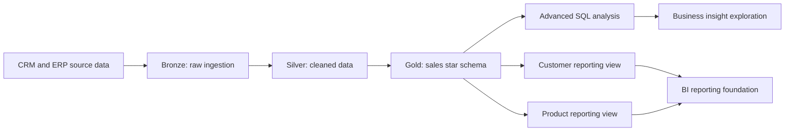

# Advanced SQL Analytics | Customer & Product Intelligence

[Explore my portfolio](https://sharankumarsrathod12345.github.io/) · [Discuss a project on Upwork](https://www.upwork.com/freelancers/~01db224cb89f18ba29)

**Sales trends · Cohort retention · Customer segmentation · Product performance · SQL Server**

A business-focused SQL analytics case study built on a **Bronze → Silver → Gold Medallion Data Warehouse**. This project transforms the modeled sales data into deeper historical analysis and two reusable reporting views: one for customers and one for products.

> **Project at a glance:** 60,398 transaction records · 27,659 distinct orders · 18,484 customer records · 295 products in the supplied snapshot. All metrics below describe a historical practice dataset, not a live company or client deployment.

## Review this project in three steps

1. Read the [business case and method](docs/business-case-and-method.md) for the stakeholder questions and analytical approach.
2. Review the findings below alongside the [metric definitions and limitations](docs/metric-definitions-and-limitations.md).
3. Inspect the original SQL and [supporting diagnostic queries](tests/data_quality_checks.sql) for the implementation.

This demonstrates a documented analytical reporting foundation. Native SQL Server execution and reconciliation of the reporting views remain separate validation steps.

## Business challenge

Retail stakeholders can see transaction totals but also need answers to more complex questions:

- **Revenue:** Which periods contributed most to sales, and how do results change over time?
- **Customer behavior:** Which customers generate higher sales, and how consistently do customers return?
- **Product mix:** Which categories and products account for sales, volume, and repeat purchasing?
- **Reporting:** How can these questions be answered consistently from a reusable SQL reporting layer?

## Solution and deliverables

| Deliverable | Business purpose | SQL methods |
| --- | --- | --- |
| [Advanced analytics](sql/01_advanced_sql_analytics.sql) | Explore trends, cumulative measures, product comparisons, customer segments, category contribution, annual repeat purchasing and monthly cohorts | CTEs, `DATETRUNC`, window aggregates, `LAG`, `CASE`, date arithmetic |
| [Customer reporting view](sql/02_customer_analytics_report.sql) | Summarize purchasing behavior, sales, orders, recency, spending groups and average-value metrics at customer level | Multi-stage CTEs, joins, distinct counts, views |
| [Product reporting view](sql/03_product_performance_report.sql) | Summarize product sales, units, customers, frequency, recency and product performance groups | Joins, aggregation, segmentation, views |

**The three SQL files above are my original course capstone submissions and are preserved unchanged.** Supporting documentation and diagnostic checks are kept separate from the analytical scripts.

## Data architecture



**Source model:** `gold.fact_sales` joins to `gold.dim_customers` and `gold.dim_products`. The upstream warehouse is documented in the [SQL Data Warehouse project](https://github.com/sharankumarsrathod12345/sql-data-warehouse-project). For additional initial exploration, see [Medallion Warehouse & EDA](https://github.com/sharankumarsrathod12345/medallion-warehouse-eda-analytics).

## Dataset overview and exploratory findings

| Metric | Value | Interpretation |
| --- | ---: | --- |
| Recorded sales amount | 29,356,250 | Currency is not specified in the source snapshot |
| Distinct orders | 27,659 | Counted by distinct order number, not fact rows |
| Sales fact records | 60,398 | Sales records can belong to the same order |
| Units sold | 60,423 | Sum of recorded quantity |
| Customer dimension records | 18,484 | Includes all customer dimension rows |
| Product dimension records | 295 | Catalog products represented in the dimension |
| Products with observed sales | 130 | Not equivalent to total catalog products |

**What the snapshot suggests:** Bikes contribute the vast majority of recorded sales amount (about **96.46%**), while accessories account for the highest unit volume (about **59.77%**). This is an important revenue-versus-volume distinction worth investigating further; the dataset alone cannot establish the business causes.

The historical order dates span **December 29, 2010 through January 28, 2014**. The first and last calendar years are incomplete. In addition, **19 fact rows** lack an order date (sales amount **4,992**), so time-based totals differ from the complete fact-table total. See [Metrics & analysis boundaries](docs/metric-definitions-and-limitations.md).

## Repository layout

```text
advanced-sql-analytics-reports/
├── README.md
├── PORTFOLIO_ENTRY.md
├── sql/
│   ├── 01_advanced_sql_analytics.sql       
│   ├── 02_customer_analytics_report.sql    
│   └── 03_product_performance_report.sql   
├── tests/
│   └── data_quality_checks.sql            
└── docs/
    ├── business-case-and-method.md
    └── metric-definitions-and-limitations.md
```

## Reproduce the analysis

**Environment:** SQL Server **2022+** (the scripts use `DATETRUNC`), SSMS, and the companion Gold-layer warehouse. Select the warehouse database before execution.

1. Run the optional [source data-quality checks](tests/data_quality_checks.sql) to inspect join integrity, missing dates and baseline totals.
2. Execute the independent analysis sections in [the advanced analytics script](sql/01_advanced_sql_analytics.sql).
3. In a **development database**, review the reporting scripts and then execute them to create `gold.report_customers` and `gold.report_product`. The originals contain `DROP VIEW` / `CREATE VIEW` statements; do not run them against important existing objects without reviewing dependencies and permissions.
4. Query the resulting views and reconcile counts and sales figures against the Gold fact table with consistent date filters.

## Analytical integrity and scope

The supporting [metric dictionary](docs/metric-definitions-and-limitations.md) explains reporting grain, partial periods, missing dates and known considerations in the original SQL. The [business case](docs/business-case-and-method.md) maps the analysis to stakeholder questions.

**Evidence boundary:** The three supplied warehouse exports confirm the snapshot totals and the Gold columns used by the original reports (`birth_date`, `sub_category`, `product_cost`). See the [export reconciliation](https://github.com/sharankumarsrathod12345/medallion-warehouse-eda-analytics/blob/60dd9b6a18e859ec9c72554c4ea70bb55917ef36/README.md#verification-status). CSV snapshot aggregates have been independently checked; live SQL Server execution, optimization benchmarks, dashboard deployment and real-client impact are not claimed. The SQL files are intentionally preserved as written rather than silently revised for the portfolio.

---

**Author:** Sharan Kumar Rathod · **Tools:** SQL Server, SSMS, T-SQL, CTEs, window functions, dimensional modeling, analytical views.
